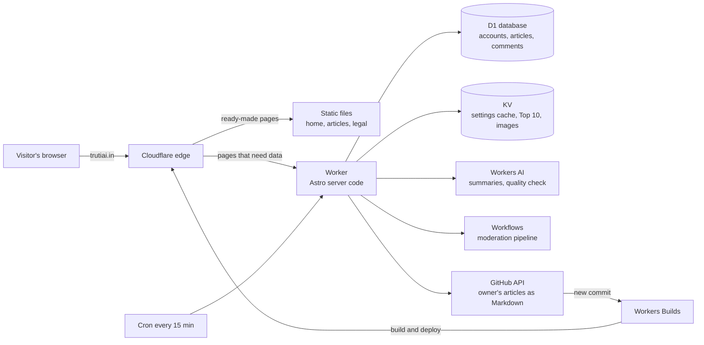

# How TrutiAI was built

A plain-language tour of what TrutiAI is, what was built between 12 and 19 November 2026, and how each tool and
framework is used. For the full detail behind each choice see `docs/DECISIONS.md` (D-001 to D-037); for every file
see `docs/FILES.md`.

---

## 1. What TrutiAI is

TrutiAI (https://trutiai.in) is a Medium-style tech publication. The owner writes editorial articles; anyone can
sign in with Google and write community articles, which are checked automatically and by an editor before they go
live. Students join through an internship and publish articles about projects they build. The business goal is
Google AdSense income, and everything runs on free plans: **the only paid item is the domain**.

---

## 2. What we built, day by day

| Date | What was built |
|---|---|
| 12 Nov | Project set up on Cloudflare Workers. Public site: home, about, contact form, legal pages (privacy, terms, disclaimer, editorial policy, community guidelines), SEO tags, sitemap, RSS, search, share images. Site live on trutiai.in. |
| 15 Nov | Community publishing: Google sign-in, the article editor, the automatic moderation pipeline, community pages, comments, "raises" (upvotes), view counts, reader reports, Top 10, the admin dashboard. |
| 16 Nov | Editor redesign (block editor, "/" menu, image uploads, AI summary, SEO fields, scheduling). Owner's articles publish from the editor to `/blog/`. Version history, conflict protection, writer dashboard, admin tools (audit log, export, emergency switches). Explore page, bookmarks, notifications, comment edit/delete. Campus Writers Programme (built, switched off). Internship codes. New brand (purple, logo, favicon), redesigned home page, live header search, account menu. Fixes: article spacing, image insert, India time, cache privacy. |
| 17 Nov | Search engine clean-up: 301 redirects for removed pages, sitemap limited to indexable pages. R2 image storage built (waiting for R2 to be enabled). |
| 19 Nov | robots.txt fixed so writer profiles are no longer blocked. |

In numbers: 28 commits, 6 database migrations, 37 recorded decisions, 13 browser test suites and 5 unit test files.

---

## 3. The big picture

Two kinds of pages:

- **Static pages** (home, owner's articles, About, legal pages) are built once into plain HTML files. Cloudflare
  serves them from its network for free, with no limit and no code running.
- **On-demand pages** (community articles, Explore, the editor, `/me`, `/admin`, everything under `/api/`) run code
  in a Cloudflare Worker, because they show data that changes or depends on who is signed in.

---

## 4. How each tool is used

### Cloudflare (free plan): hosting and backend

| Tool | How TrutiAI uses it |
|---|---|
| **Workers** | Runs all server code: sign-in, the editor's save and publish actions, community pages, admin pages, search, comments, reports. One Worker named `trutiai`. |
| **Workers Static Assets** | Serves the pre-built HTML, CSS, JavaScript, images and fonts straight from Cloudflare's network. |
| **D1** (SQLite database) | Stores accounts, sessions, community articles (with their editor JSON and rendered HTML), tags, comments, raises, views per day, reports, moderation log, audit log, notifications, bookmarks, internship codes and settings. Database changes are migration files in `drizzle/`. |
| **KV** (key-value store) | Small fast data: Top 10 lists, daily limits (AI summaries, image uploads), and images uploaded before R2. Its free plan allows only 1,000 writes a day, so it is used sparingly. |
| **R2** (file storage) | Built for uploaded images (10 GB free, no fees for visitors viewing them). Waiting for R2 to be enabled on the account, then images move there. |
| **Workers AI** | Runs the AI model `@cf/openai/gpt-oss-20b` for the summary field in the editor and the spam/quality check; `llama-guard-3-8b` is the safety backup. The model name is a setting, not code, so it can be changed from `/admin`. |
| **Workflows** | The moderation pipeline: a multi-step job (rules, safety, quality, decision, publish) that retries steps on its own if one fails. |
| **Cron Triggers** | A job every 15 minutes: publishes scheduled articles, rebuilds the Top 10 lists, cleans the trash. |
| **Cache API** | Keeps community pages and Explore results at the edge for 10 minutes, so most visits do not touch the database. Private previews are never cached. |
| **Workers Builds** | Connected to the GitHub repository: every push to `main` builds the site and deploys it automatically. This is what we use **instead of GitHub Actions**. |
| **DNS and custom domain** | trutiai.in and www.trutiai.in point to the Worker. |

### GitHub

| Use | How |
|---|---|
| **Code repository** | `github.com/akhil6174/blog` holds all code and docs. Every change is a commit; pushing to `main` triggers Workers Builds. |
| **Publishing the owner's articles** | When the admin presses **Publish to blog**, the Worker turns the article into a Markdown file and commits it to `src/content/posts/` through the GitHub API (using a secret token). That commit triggers a new build, and about 2 to 3 minutes later the article is live as a fast static page. |
| **Not used: GitHub Actions** | Not needed, because Cloudflare Workers Builds does the building and deploying. |

### Website framework and libraries

| Tool | How it is used |
|---|---|
| **Astro** | The site framework. Builds static pages and also runs the on-demand pages in the Worker (through `@astrojs/cloudflare`). Server islands load small live parts (comments, "From the community") inside static pages. |
| **Preact** | Small React-compatible library for the interactive parts ("islands"): the editor, raise button, report form, save/share buttons, comment form. |
| **Tailwind CSS** | All styling, with brand colours defined once as design tokens; the Typography plugin formats article text. |
| **Tiptap** | The article editor: headings, lists, tables, code blocks with highlighting (lowlight), images, links, YouTube, highlight, character count, plus our own "/" menu and block handle. |
| **Better Auth** | Sign-in and sessions, with "Continue with Google" (Google Cloud OAuth). Roles: reader, writer, trusted, admin. |
| **Drizzle ORM and Drizzle Kit** | Type-safe database queries, and generating the migration files when the database changes. |
| **Zod** | Checks every form and request on the server before anything is saved. |
| **sanitize-html** | Cleans community article HTML so nothing harmful is ever published. |
| **@astrojs/sitemap, @astrojs/rss, astro-og-canvas** | The sitemap for Google, the RSS feed, and the share images for social media. |
| **Lucide** | Icons. |

### Building, testing and running

| Tool | How it is used |
|---|---|
| **Node.js, npm, TypeScript** | Run, install and write everything. |
| **Wrangler** | Cloudflare's command line: database migrations, backups (`npm run db:backup`), local preview, checks on the live database. |
| **Playwright** | Browser tests that click through the real site (13 suites, for example the editor alone has 64 checks), and the script that draws the logo icons and share image (`npm run brand`). |
| **Vitest** | Unit tests for the Markdown converter, image checks, moderation rules, HTML renderer and settings. |
| **Claude Code** | Built, tested and documented the site with the owner. |

### Outside services (free plans)

| Service | Purpose | Status |
|---|---|---|
| Google Cloud (OAuth) | "Continue with Google" sign-in | Working |
| Google Search Console | Sitemaps, indexing, crawl reports | Set up |
| Google AdSense | Ads | Apply once there are enough articles |
| Resend | Emails (contact form, decisions, reports) | Needs API key |
| OpenAI Moderation API | Free harmful-content check | Needs API key |
| Cloudflare Turnstile | Bot protection on forms | Needs site key |
| Cloudflare Web Analytics | Visitor statistics | Needs token |

---

## 5. How the main things work

### A visitor reads an article
1. The owner's articles are static files: Cloudflare sends them instantly, no code runs.
2. Community articles run in the Worker once, then stay in the edge cache for 10 minutes.
3. Comments, raises and the "save" button load separately, so the article itself can stay cached.

### A community writer publishes
1. The writer signs in with Google and writes in the editor (it autosaves; every save keeps a version).
2. **Submit for review** starts the moderation Workflow:
   - **Rules:** length (600 words minimum), links, duplicates, posting limits.
   - **Safety:** OpenAI's free moderation check (Llama Guard on Workers AI as backup).
   - **Quality:** a score from the Workers AI model.
   - **Decision:** publish, send to the editor's review queue, or decline with a reason.
3. The writer gets a notification (and an email once Resend is connected).
4. A community article is only shown to Google (and later gets ads) when moderation marks it good enough, which protects the AdSense review.

### The owner publishes an editorial article
1. Written in the same editor. **Publish to blog** (or **Schedule**) turns it into Markdown.
2. The Worker commits the file to GitHub; Workers Builds rebuilds and deploys; the article appears at `/blog/<slug>/`.
3. Scheduled articles are published by the 15-minute cron job.

### Images
1. The browser compresses and crops the image before uploading (no heavy work on the server).
2. The Worker checks the real file type and size and stores it (KV today, R2 once enabled).
3. Images are served from `/media/...` and cached for a year.

### Deploying a change
1. Change the code, run the tests locally (`npm run build`, `npm run preview`, the Playwright suites).
2. If the database changes: generate a migration, then apply it to the live database (`npx wrangler d1 migrations apply tech-blog-db --remote`) before pushing.
3. Commit and push to GitHub: Workers Builds deploys within about 2 to 3 minutes.

### Internships
1. The owner recruits on LinkedIn and gives each intern unique projects by email.
2. On `/admin/internships` the owner creates a code tied to the intern's Google email.
3. The intern pastes the code above **Submit for review**; the page counts published articles per code and shows who is ready for a certificate.

---

## 6. Staying free

| Free limit | How the site stays inside it |
|---|---|
| Worker: 100,000 requests a day, 10 ms CPU each | Most pages are static files, which do not count. No image processing or heavy work in the Worker. |
| D1: 5 million reads, 100,000 writes a day | Counters stored on the article row; views sampled on busy days; raises sent once, not per click. |
| KV: 1,000 writes a day | Only cron, admin actions, daily limits and (until R2) images write to KV. |
| D1: at most 100 values per database statement | Long lists are split into chunks (`src/lib/db/chunk.ts`). |

---

## 7. Where to read more

| File | What it covers |
|---|---|
| `docs/SETUP-GUIDE.md` | Step-by-step owner setup: Cloudflare, Google, Search Console, keys, backups, programme, internships |
| `docs/ARCHITECTURE.md` | Technical overview: data model, routes, bindings |
| `docs/DECISIONS.md` | Why each choice was made (D-001 to D-037) |
| `docs/CHANGELOG.md` | Every change, by date |
| `docs/PROGRESS.md` | What is done and what is waiting |
| `docs/FILES.md` | What every file does |
| `README.md` | Commands and first-time setup |
